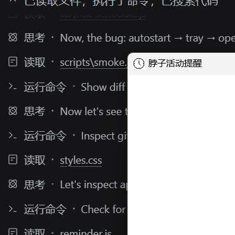
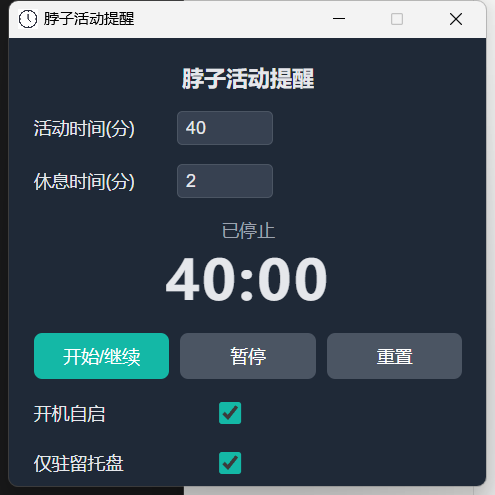

# 开机自启后托盘打开是空白窗口 — 根因与修复

日期：2026-10-29
状态：已修复（v1.2.1）

## 现象

升级到 1.2.0（便携版 `ticktockneck 1.2.0.exe`）并勾选「开机自启 + 仅驻留托盘」后，
重启电脑，托盘图标在，点它也能弹出标题为「脖子活动提醒」的窗口，但**窗口里一片空白**，
没有任何控件，也不能用。



修复后同一个便携版从托盘打开的样子（注意「开机自启」「仅驻留托盘」也都正确显示为已勾选）：



## 根因

一条四环相扣的链路，缺一环都不会有这个症状：

### 1. 便携版不是"就地运行"的

electron-builder 的 `portable` 目标是个 NSIS 自解压引导器
（`node_modules/app-builder-lib/templates/nsis/portable.nsi`）：

```
StrCpy $INSTDIR "$PLUGINSDIR\app"      ; 每次启动解包到 %TEMP% 下的随机目录
File /r ...                            ; 把整个 win-unpacked 铺进去
ExecWait "$INSTDIR\ticktockneck.exe"   ; 运行解包出来的副本
RMDir /r $INSTDIR                      ; 进程退出后把目录删掉
```

所以运行时 `process.execPath` 是 **`%TEMP%\<随机>\ticktockneck.exe`**，
不是用户双击的那个便携 exe。引导器只会把真实路径放进环境变量
`PORTABLE_EXECUTABLE_FILE`。

### 2. 登录项被写成了临时副本的路径

`app.setLoginItemSettings()` 不传 `path` 时默认用 `process.execPath`。
本机注册表里实际写的就是：

```
HKCU\Software\Microsoft\Windows\CurrentVersion\Run
  electron.app.ticktockneck =
    C:\Users\ROG\AppData\Local\Temp\3KwrfGCPgTnLR90INau8JJKcBW7\ticktockneck.exe --hidden
```

### 3. 那个临时目录退出即删，只剩残骸

`RMDir /r` 是尽力而为：仍在被占用的文件删不掉，系统清理也会来删一部分。
本机这个目录被删得只剩 `ticktockneck.exe` + 几个 dll + `resources\app.asar`，
**Chromium 的 `resources.pak`、`chrome_100_percent.pak`、`chrome_200_percent.pak`
和 `locales\*` 全没了**。程序自己的 `debug.log` 把这件事记得很清楚：

```
[1029/103230.906:ERROR:resource_bundle.cc(1031)] Failed to load ...\chrome_100_percent.pak
[1029/103230.906:WARNING:resource_bundle.cc(466)] locale_file_path.empty() for locale
[1029/103230.906:ERROR:resource_bundle.cc(1031)] Failed to load ...\resources.pak
```

### 4. 窗口没画出首帧，却被 `show()` 了出来

主窗口是 `show: false` + `ready-to-show` 再显示的。缺资源包时渲染进程画不出任何像素，
`ready-to-show` **永远不触发**，窗口就一直隐形。而 `showMainWindow()` 原来的逻辑是
"窗口已存在就直接 `show()`"——用户第二次点托盘，就把这个从没绘制过的窗口显示了出来。
Windows 给的是一个带标题栏、内容区全白的空壳，正好是用户看到的"打开了但里面什么都没有"。

实测复现：把 `dist\win-unpacked` 复制一份，删掉上述资源包后启动，7 秒后枚举窗口得到
`hidden | Chrome_WidgetWin_1 | 脖子活动提醒`；把它 `ShowWindow` 出来截图即上图。

## 修复

### 1. 登录项指向稳定路径（`lib/autostart.js`）

- `resolveAutostartPath()`：按 `PORTABLE_EXECUTABLE_FILE` → 上次记住的便携 exe 路径 →
  `process.execPath` 的顺序取第一个**不在临时目录**的候选；全都不可用时返回 `null`。
- `isTempPath()`：按目录边界、大小写无关地判断路径是否落在 `app.getPath('temp')` 下。
- `parseRunKeyEntries()` / `commandExecutable()` / `staleLoginItemNames()`：解析
  `reg query HKCU\...\Run` 的输出，找出"命令行指向临时目录、且 exe 名字和自己一样"的条目。

`main.js` 里 `applyLoginItem()` 改为带 `path` 注册，并先删掉历史坏条目；
拿到不稳定的路径时**宁可不注册**，也不再往登录项里写一个下次开机必然失效的路径。
`config.json` 新增 `portableExe`，一旦从引导器拿到真实路径就记下来，供下次从临时副本
启动时自愈使用。

> 为什么直接读注册表：`getLoginItemSettings().launchItems` 实测**恒为空** —— Electron
> 会把"自己那条"排除掉，而我们那条的名字（`electron.app.ticktockneck`）正是它认自己
> 的依据。旧版本用它做的 `--hidden` 迁移其实一直没有生效。改用 `reg query` 后既能
> 看到真实数据，也能精确删除。

### 2. 启动期自愈（打包版才执行）

`app.whenReady()` 里调用 `applyLoginItem()`：删除指向 `%TEMP%` 的旧条目，再按当前设置
重新注册到稳定路径。开发运行（`npm start`）不会去动系统登录项。

`settings:getAutostart` 也改成按登录项真正指向的路径查询——否则便携版跑在临时副本里时，
`getLoginItemSettings()` 会把"其实已注册到便携 exe 的自启"错报成关闭，勾选框一直是空的。

### 3. 绝不再显示未绘制的窗口

- 新增 `mainWindowPainted`（由 `ready-to-show` 置位）；
  `showMainWindow()` 在首帧到来前只等不 `show()`。
- 看门狗 8 秒：仍未绘制就销毁窗口并弹出一次说明性错误框（含缺失的资源文件名、
  以及应该直接运行的便携 exe 路径），而不是留个空白窗口让用户反复点。
- `render-process-gone`（crashed / oom / launch-failed 等）同样收掉窗口，下次点托盘重建。

## 影响面

| 文件 | 变更 |
|------|------|
| `lib/autostart.js` | 新增：`isTempPath` / `resolveAutostartPath` / `parseRunKeyEntries` / `commandExecutable` / `staleLoginItemNames` 纯函数 |
| `main.js` | 登录项带稳定 `path` 注册 + 启动自愈；`portableExe` 持久化；首帧守卫与看门狗；`render-process-gone` 处理 |
| `test/autostart.test.js` | 新增 11 个单测 |
| `scripts/smoke.js` | 新增两项断言：窗口只在首帧之后才展示 |
| `package.json` | 1.2.0 → 1.2.1 |

## 验证

- `node --test`：38 项全绿（27 + 11）。
- `npm run smoke`：17 项全绿；`npm run smoke -- --hidden`：6 项全绿。
- 打包后运行 `dist\ticktockneck 1.2.1.exe`：注册表条目被改写为指向便携 exe
  （不再是 `%TEMP%` 路径），从托盘打开的主窗口正常渲染。

## 给用户的一次性善后

坏条目是**旧版本**写进注册表的，新版本第一次运行时会自动改掉它。所以在装好 v1.2.1 后
**手动运行一次** `ticktockneck 1.2.1.exe`（或 `npm run dist` 之后运行产物），让它把
`HKCU\...\Run\electron.app.ticktockneck` 改写为便携 exe 的路径即可；之后开机自启就稳定了。
